<p align="center">
  
</p>

<h1 align="center">EduRecommend</h1>

<p align="center">
  <b>University and programme guidance for students in Pakistan</b><br>
  Find out which degree programmes you meet the published admission requirements for,
  understand <i>why</i>, and compare your options in one place.
</p>

<p align="center">
  
  
  
  
  
</p>

---

## Table of contents

- [About](#about)
- [Features](#features)
- [Screenshots](#screenshots)
- [How eligibility works](#how-eligibility-works)
- [Tech stack](#tech-stack)
- [Architecture](#architecture)
- [Getting started](#getting-started)
- [Running the tests](#running-the-tests)
- [Configuration](#configuration)
- [Project structure](#project-structure)
- [Documentation](#documentation)
- [Roadmap](#roadmap)

---

## About

Admission rules in Pakistan are spread across hundreds of university websites and prospectuses.
They differ by background (FSc Pre-Engineering, Pre-Medical, ICS, I.Com, FA, A-Levels, DAE),
by campus and by year, so students often rely on social-media posts.

**EduRecommend** puts verified admission rules in one place. A student enters their education,
subjects, marks and preferences; the app checks every programme against its **published
requirements** and explains each result in plain language, with a link to the official source.

> **Eligible is not admitted.** The app shows whether a student meets the *minimum published
> requirements*. Final admission depends on merit, seats and the university — the app says so on
> every results screen.

The project has three parts:

| Part | For | Built with |
|---|---|---|
| **Student app** | Students (Android, iPhone, web) | Flutter |
| **Admin panel** | Staff who enter and verify university data | Flutter Web |
| **Backend** | API, database and the eligibility engine | Python, FastAPI |

## Features

### Student app
- **Account and profile** — sign up / log in, Matric and Intermediate / A-Level / DAE records,
  subjects pre-filled per group, marks with automatic percentage, **Part-I marks** for students
  waiting for results, IBCC equivalence for A-Levels, entry-test scores.
- **Preferences** — provinces, budget per semester (tuition only / all charges / with hostel),
  university type, hostel need, campus type, class timing, accreditation.
- **Recommendations in three groups** — *Eligible*, *Potentially eligible*, *Not currently
  eligible*, ranked by how well they fit the preferences.
- **"Why" for every result** — rule-by-rule explanation, next steps, fees, entry tests, dates,
  hostels and the official source with its verification date.
- **Helpful no-match screens** — if the background does not fit the chosen field, the app
  suggests fields the student *does* qualify for; if only preferences block results, it shows
  which change would unlock how many options.
- **Search, filters, university pages, shortlist and compare** (up to three programmes).
- **Privacy** — download all personal data or delete the account at any time.

### Admin panel
- Manage **universities, campuses, hostels, programmes and yearly offerings**.
- **No-code rule builder**: accepted groups, required subjects, minimum percentage, entry tests,
  deficiency courses, Part-I marks, IBCC, gender, domicile, age limit and more.
- **Test rules against nine sample students** before saving.
- **Fees, entry tests and dates** per admission year, with automatic totals.
- **Four-eyes review**: drafts and changes to live data must be approved by a *different* staff
  member; students keep seeing the published version until then. Review cards show only what
  changed (e.g. `PKR 30,000 → PKR 34,000`).
- **Student error reports**, full **change history**, admission cycles, staff roles
  (super admin, data editor, data verifier, support).

## Screenshots

> The universities shown are **fictional sample data** ("Demo …", labelled *SAMPLE DATA*).

### Student app

| Welcome | Dashboard | Results | Why eligible |
|:---:|:---:|:---:|:---:|
| 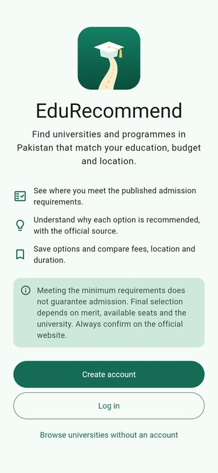 | 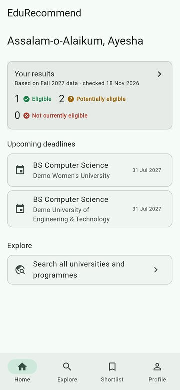 | 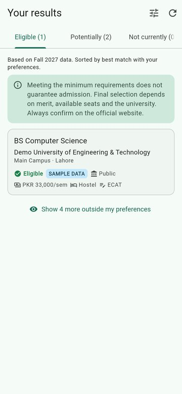 | 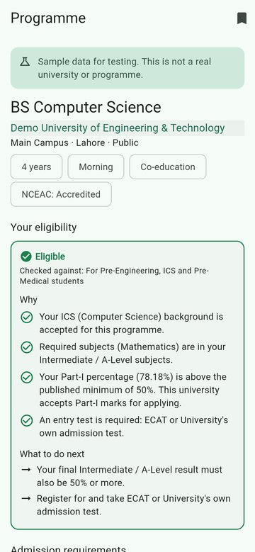 |

| Compare | No match — suggestions |
|:---:|:---:|
| 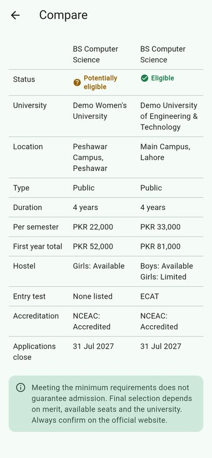 | 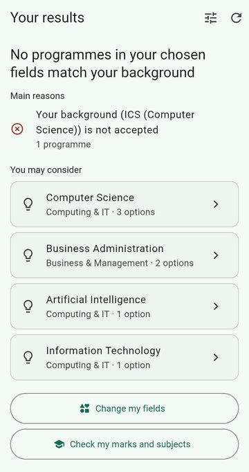 |

### Admin panel

| Dashboard | Review queue (only what changed) |
|:---:|:---:|
| 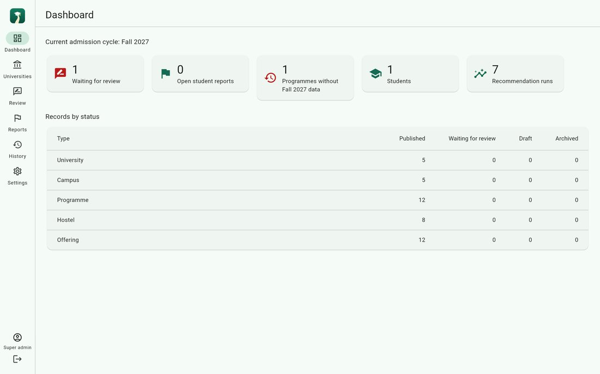 | 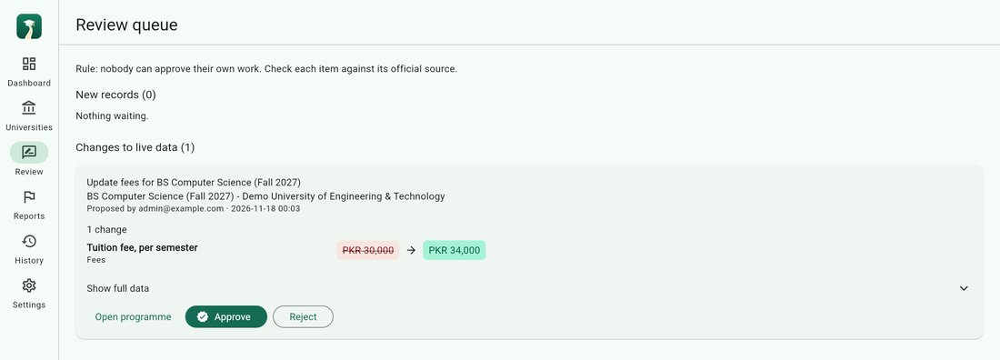 |

| No-code rule builder | Testing rules with sample students |
|:---:|:---:|
| 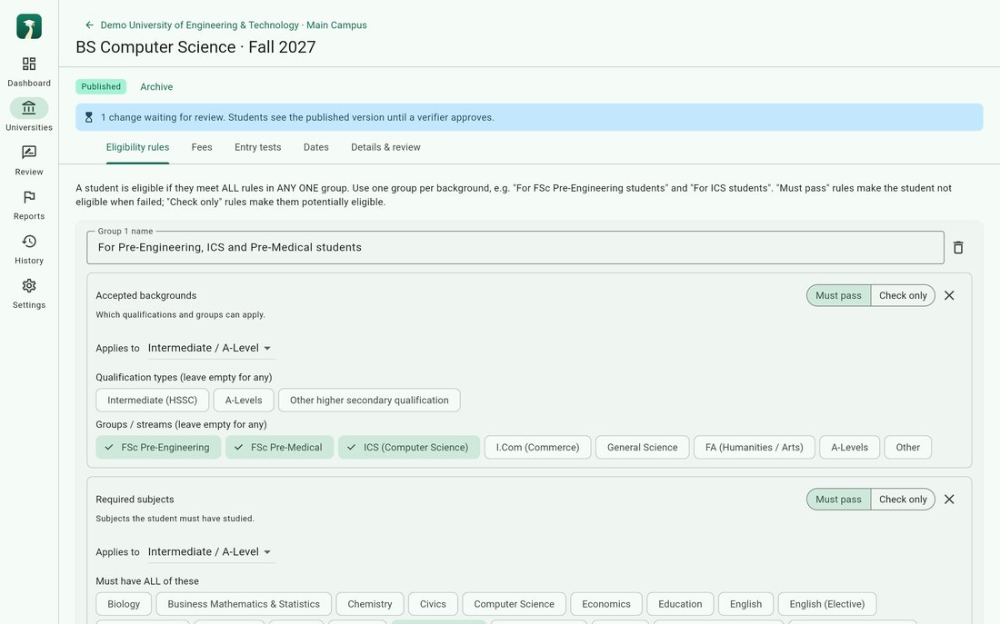 | 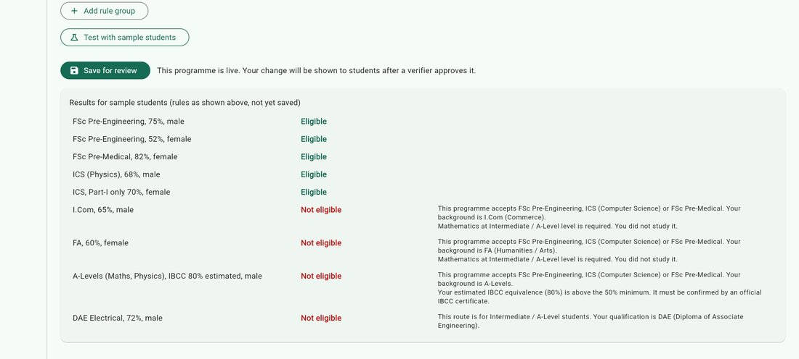 |

## How eligibility works

Eligibility is decided by a **deterministic rules engine** (`backend/app/engine/`), not by AI:
the same profile and the same rules always give the same answer.

1. Each programme has one or more **rule groups** (e.g. *"For ICS students"*,
   *"For DAE students"*). A student is eligible if they pass **all rules in any one group**.
2. Every rule returns **pass**, **fail** or **unknown** (unknown = something cannot be confirmed
   yet, such as a final result, an IBCC certificate or an interview).
3. The result is grouped as:

| Group | Meaning |
|---|---|
| ✅ **Eligible** | Every rule passes. |
| 🟡 **Potentially eligible** | No hard rule fails, but at least one is unknown. |
| ❌ **Not currently eligible** | At least one hard rule fails — the app says which one. |

4. **Preferences never change eligibility.** Budget, location and hostel only affect ordering and
   which results are shown first.
5. Data from an older admission year is shown with a warning and never as plain *Eligible*.
6. A `strict_pdf` mode shows only *Eligible* results, matching the original specification exactly.

Full design: [docs/RECOMMENDATION_ENGINE.md](docs/RECOMMENDATION_ENGINE.md).

## Tech stack

| Layer | Technology |
|---|---|
| Student app | Flutter 3.50 (Dart 3), Riverpod, go_router, Dio, flutter_secure_storage |
| Admin panel | Flutter Web (same stack) |
| Backend API | Python 3.12, FastAPI, Pydantic, Uvicorn |
| Database | SQLAlchemy 2 — SQLite for development, PostgreSQL (e.g. Supabase) planned for production |
| Auth | Argon2 password hashing, JWT access tokens, role-based access |
| Eligibility | Custom rules engine with plain-English explanations |
| Tooling | uv (Python), Flutter CLI, pytest, Ruff, flutter_test, Git |

## Architecture

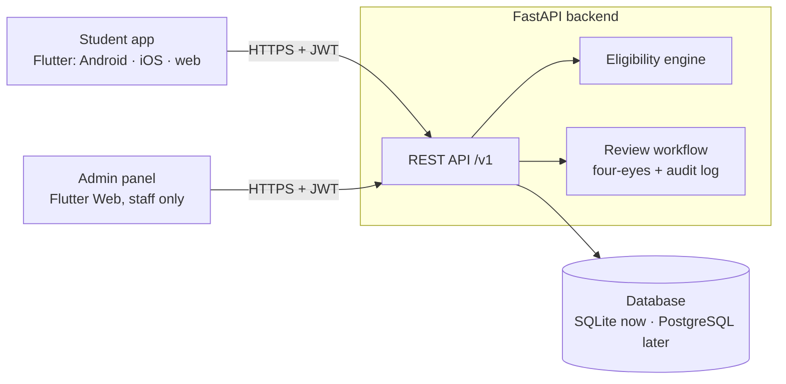

Students and staff never access the database directly; every rule, fee and hostel record carries
an official source and a verification status.

## Getting started

### Requirements
- Windows 10/11 (the helper scripts are PowerShell; the code itself is cross-platform)
- [Git](https://git-scm.com/), [uv](https://docs.astral.sh/uv/),
  [Flutter](https://docs.flutter.dev/get-started/install) (stable) and Google Chrome

### Quick start (Windows)

```powershell
git clone https://github.com/JawadYaseenDev/EduPath.git
cd EduPath
```

On a laptop with **nothing installed**, one script installs Git, Chrome, uv and Flutter and then
sets up the project (it asks before installing anything):

```powershell
powershell -ExecutionPolicy Bypass -File scripts\install-everything.ps1
```

If the tools are already installed, set up once:

```powershell
powershell -ExecutionPolicy Bypass -File scripts\setup.ps1
```

Then start everything (backend, student app and admin panel open in their own windows):

```powershell
powershell -ExecutionPolicy Bypass -File scripts\start.ps1
```

| What | Where |
|---|---|
| Student app | http://localhost:5173 |
| Admin panel | http://localhost:5174 |
| API docs (Swagger) | http://localhost:8000/docs |

**Admin login (development only):** `setup.ps1` creates `backend/.env` with a random password.
Sign in as `admin@example.com` (super admin) or `verifier@example.com` (data verifier) using the
value of `UNIRAH_DEV_STAFF_PASSWORD` in that file. To try the four-eyes review, make a change as
one user and approve it as the other.

### Manual start

```powershell
# 1. Backend
cd backend
uv sync
uv run python -m uvicorn app.main:app --port 8000
```
```powershell
# 2. Student app (new window)
cd mobile
flutter pub get
flutter run -d chrome --web-port 5173
```
```powershell
# 3. Admin panel (new window)
cd admin
flutter pub get
flutter run -d chrome --web-port 5174
```

- **Reset demo data:** stop the backend, delete `backend/dev.db`, start it again.
- **Android emulator:** see [docs/ANDROID_EMULATOR_SETUP.md](docs/ANDROID_EMULATOR_SETUP.md).
  The emulator reaches the backend at `10.0.2.2:8000` automatically; a real phone needs
  `--dart-define=API_BASE_URL=http://<laptop IP>:8000` and the backend started with `--host 0.0.0.0`.
- **Another laptop:** see [docs/SETUP_ON_ANOTHER_LAPTOP.md](docs/SETUP_ON_ANOTHER_LAPTOP.md).

## Running the tests

```powershell
cd backend; uv run python -m pytest     # 58 tests: engine, student API, admin workflow
cd mobile;  flutter test                # 5 widget tests
cd admin;   flutter test                # 1 rule-builder widget test
```

## Configuration

Backend settings come from environment variables or `backend/.env`
(see [`backend/.env.example`](backend/.env.example)):

| Variable | Default | Purpose |
|---|---|---|
| `UNIRAH_DATABASE_URL` | `sqlite:///./dev.db` | Database connection |
| `UNIRAH_JWT_SECRET` | development value | **Required** outside development |
| `UNIRAH_RESULT_MODE` | `extended` | `extended` or `strict_pdf` |
| `UNIRAH_LOAD_DEMO_DATA` | `true` | Seed the fictional demo universities |
| `UNIRAH_DEV_STAFF_PASSWORD` | — | Development only: creates the two staff accounts |

Create real staff accounts with:

```powershell
cd backend; uv run python -m app.cli create-staff someone@example.com data_editor
```

> The `UNIRAH_` prefix and the Dart package names come from the project's earlier working name and
> are kept so existing setups keep working.

## Project structure

```
EduPath/
├── backend/            FastAPI backend
│   ├── app/
│   │   ├── engine/     Eligibility rules engine (pure Python, fully tested)
│   │   ├── api/        REST endpoints (auth, profile, catalogue, recommendations, admin)
│   │   ├── services/   Business logic (catalogue, review workflow, change summaries)
│   │   ├── models.py   Database tables
│   │   └── seed.py     Reference lists + fictional demo universities
│   └── tests/          58 automated tests
├── mobile/             Student app (Flutter: Android, iOS, web)
├── admin/              Admin panel (Flutter Web)
├── branding/           Logo source (make_logo.py) and exported icons
├── docs/               Requirements, architecture, database, engine, UI/UX, roadmap, guides
├── scripts/            install-everything / setup / start (PowerShell)
└── tools/showcase/     Scripts that capture screenshots and build the overview PDF
```

## Documentation

| Document | Contents |
|---|---|
| [PROJECT_OVERVIEW](docs/PROJECT_OVERVIEW.md) | Goals, users, principles |
| [FUNCTIONAL_REQUIREMENTS](docs/FUNCTIONAL_REQUIREMENTS.md) | FR-01 to FR-06 and detailed requirements |
| [NON_FUNCTIONAL_REQUIREMENTS](docs/NON_FUNCTIONAL_REQUIREMENTS.md) | Performance, security, privacy, usability |
| [SYSTEM_ARCHITECTURE](docs/SYSTEM_ARCHITECTURE.md) | Technology choices and comparisons |
| [DATABASE_DESIGN](docs/DATABASE_DESIGN.md) | Tables and relationships |
| [RECOMMENDATION_ENGINE](docs/RECOMMENDATION_ENGINE.md) | Eligibility and ranking logic |
| [ADMIN_PANEL_PLAN](docs/ADMIN_PANEL_PLAN.md) | Data management and review workflow |
| [UI_UX_PLAN](docs/UI_UX_PLAN.md) | Screens and user journeys |
| [RAG_CHATBOT_ARCHITECTURE](docs/RAG_CHATBOT_ARCHITECTURE.md) | AI assistant design (version 1.1) |
| [DEVELOPMENT_ROADMAP](docs/DEVELOPMENT_ROADMAP.md) | Phases and timeline |
| [RISKS_AND_CHALLENGES](docs/RISKS_AND_CHALLENGES.md) | Risks and mitigations |

## Roadmap

- [x] Eligibility engine with explanations and no-match suggestions
- [x] Student app (profile, results, search, shortlist, compare, privacy)
- [x] Admin panel with no-code rule builder and four-eyes review
- [ ] Enter real university data from official prospectuses
- [ ] Hosted deployment (PostgreSQL / Supabase, HTTPS)
- [ ] Email verification and two-factor login for staff
- [ ] Android release, then iOS
- [ ] AI help assistant using verified data only (v1.1)
- [ ] Deadline notifications (v1.1)

---

<p align="center"><sub>Sample data in this repository is fictional. Always confirm admission requirements on the official university website.</sub></p>
