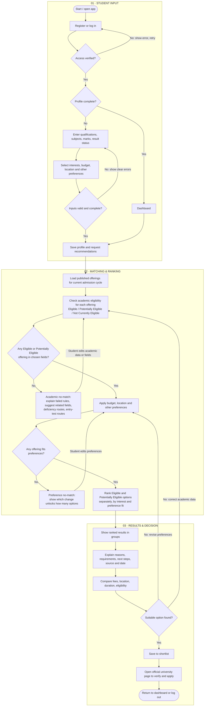

# Recommendation Engine

This is the heart of the app. It has **two separate jobs**:

1. **Eligibility** — "Does this student meet the published requirements?" → strict, rule-based, no guessing.
2. **Ranking** — "Among the results, which fit the student's wishes best?" → based on preferences.

These two jobs are kept separate on purpose. A student's budget or city preference **never** changes their eligibility status. It only changes **sorting and default visibility**.

> The engine does **not** use AI to decide eligibility. It is plain, tested code that reads rules from the database. The AI assistant can only *explain* stored results.

---

## 0. End-to-end workflow (aligned with the Workflow PDF)

This is the corrected version of the student workflow in `Student_Recommendation_Workflow_and_Requirements-1.pdf`. It keeps the PDF's three stages (**01 Student Input → 02 Matching & Ranking → 03 Results & Decision**) and its rules, with four changes:

| # | Change from the PDF | Why |
|---|---|---|
| 1 | "Matching options available?" is split into **two checks**: academic match first, then preference match. | A student who fails academically cannot fix it by changing budget or location. They need a different suggestion. |
| 2 | A third result group, **Potentially Eligible**, is shown separately from Eligible. | Handles uncertain cases (result awaited, IBCC certificate missing, interview required) without relaxing eligibility. Not-eligible options are still never ranked as matches. |
| 3 | The revise loop goes back to the **right step**: academic changes → eligibility check; preference changes → preference filter. | Preferences never change eligibility, so there is no need to re-check it. Academic changes must re-check it. |
| 4 | Dashboard and logout are shown. | Matches PDF FR-01. |



**Rules from the PDF that the engine enforces:**
- *Rank only eligible offerings. Do not relax academic eligibility.* → Not Currently Eligible offerings are never ranked as recommendations. They are listed only so the student can see why. Potentially Eligible offerings are ranked in their **own** group, never mixed with Eligible.
- *Recommendations support decisions; they do not guarantee admission.* → Shown on every result screen.
- *Profile data remains editable; invalid inputs show clear errors.* → See PROF-30 – PROF-32.

### 0.1 Strict PDF mode (fallback)

The PDF is a fixed specification. Changes 1–3 above wait for supervisor approval ([CHANGE_REQUEST_FOR_SUPERVISOR.md](CHANGE_REQUEST_FOR_SUPERVISOR.md)). So the engine has one setting, `result_mode`, stored in the settings table (no code change to switch):

| Setting | Behaviour |
|---|---|
| `extended` (proposed) | Three groups, two no-match paths, revise loop goes to the right step — as described above. |
| `strict_pdf` | Exactly the PDF's flow: only **Eligible** options are ranked and shown as recommendations. Offerings that would be "Potentially Eligible" are treated as **not recommended**, with the reason "Cannot be confirmed yet: [reason]" visible on the programme's detail page. There is one no-match message: it explains the most common reasons (academic or preference) and offers both "Edit preferences" and "Edit academic profile". |

In both modes eligibility is never relaxed, and the same rule evaluator and explanations are used. Only how results are grouped and shown is different. This means approval (or rejection) of the change request does not delay development.

---

## 1. Inputs

| Input | Source |
|---|---|
| Student profile | Gender, date of birth, domicile, special categories |
| Qualifications | Level, type, group, board, year, marks, Part-I marks, result status, subjects, subject marks, IBCC equivalence |
| Test scores | Entry test, score, total (optional) |
| Preferences | Regions, cities, distance, budget + what it includes, sectors, hostel need, gender campus preference, shifts, fields/disciplines, accreditation, willing tests |
| Catalogue | All **published** offerings for the current cycle (or the latest verified cycle, with stale flag) |

## 2. Outputs (per offering)

| Output | Meaning |
|---|---|
| `category` | `eligible`, `potentially_eligible`, `not_eligible` |
| `matched_rule_set` | Which background path the student matched (e.g., "For ICS students") |
| `rule_outcomes` | One line per rule: pass / fail / unknown + reason |
| `next_steps` | Things the student must do (take ECAT, get IBCC certificate, apply before date) |
| `preference_misses` | e.g., over budget, outside chosen provinces, no hostel |
| `match_score` | 0–100, for sorting only (never shown as a "chance") |
| `data_is_stale` | Data is from an older cycle |

---

## 3. Step-by-step process

```
  Student profile + preferences
             │
             ▼
  ① Normalise inputs (percentages, subjects, equivalences)
             │
             ▼
  ② Pre-filter catalogue by field/discipline interest  ──► (if student chose "show all", skip)
             │
             ▼
  ③ For each offering → evaluate each rule set → pick best outcome
             │
             ▼
  ④ Assign category (eligible / potentially / not)
             │
             ▼
  ⑤ Check preferences → preference_misses
             │
             ▼
  ⑥ Compute match_score and sort
             │
             ▼
  ⑦ Build explanations + next steps
             │
             ▼
  ⑧ Save run (with data version + engine version)
```

### ① Normalise inputs
- Percentage = obtained ÷ total × 100, rounded to 2 decimals (we never round up to make someone pass; the rule's own rounding policy is used if stated).
- If Inter result is **awaited**, use Part-I marks as the "current" HSSC percentage and mark it `provisional`.
- A-Level / O-Level: use IBCC equivalence percentage. If the student entered an estimate (not an official certificate), mark it `estimated`.
- Build the student's subject set from their group defaults + their corrections.
- Calculate age on the rule's reference date if needed.

### ② Pre-filter
To keep it fast, only evaluate offerings in the student's chosen fields/disciplines. The student can switch to "Show all programmes I might qualify for" (discovery mode).

### ③ Evaluate rules
Each offering can have **several rule sets** (one per background). The student is checked against **each set**; the **best result** wins (eligible > potentially > not).

Inside a rule set, every rule returns one of three outcomes:

| Outcome | Meaning |
|---|---|
| `PASS` | Student clearly meets the rule |
| `FAIL` | Student clearly does not meet the rule |
| `UNKNOWN` | We cannot decide: missing student data, provisional/estimated marks, rule needs manual judgement, or the rule depends on future events (e.g., test score not yet available) |

**Examples of rule evaluation**

| Rule | Student | Outcome |
|---|---|---|
| `accepted_qualification`: HSSC groups = Pre-Engineering, ICS | FSc Pre-Engineering | PASS |
| same | FSc Pre-Medical | FAIL — unless a `deficiency_allowed` rule covers Pre-Medical, then PASS with a next step |
| `required_subjects`: all_of MATH | ICS (has Maths) | PASS |
| `min_percentage` HSSC ≥ 60 | 72% final result | PASS |
| `min_percentage` HSSC ≥ 60 | 64% Part-I only | UNKNOWN (provisional) → note: "Based on your Part-I marks you are above the minimum. Final result must also meet 60%." *(If the university officially accepts Part-I marks for applying, an admin sets `result_status.accept_part1 = true`, and the outcome becomes PASS with a note.)* |
| `min_percentage` HSSC ≥ 60 | 55% final | FAIL |
| `entry_test_required` ECAT | No score entered | PASS for eligibility-to-apply, with a **next step** "Take ECAT". If a **minimum score** is required and no score is known → UNKNOWN |
| `gender` female only | male | FAIL |
| `ibcc_equivalence_required` | A-Level with estimated equivalence | UNKNOWN — "Get your IBCC equivalence certificate" |
| `manual_note` "Interview required" | anyone | UNKNOWN (always) with the note shown |
| Rule needs data the student did not give (e.g., Maths marks) | — | UNKNOWN — "Add your Maths marks to check this" |

### ④ Assign category

For one rule set:

| Situation | Category |
|---|---|
| All rules `PASS` | **Eligible** |
| No **hard** rule `FAIL`, but at least one `UNKNOWN` (or a soft rule `FAIL`) | **Potentially Eligible** |
| At least one **hard** rule `FAIL` | **Not Currently Eligible** |

Then take the best category across all rule sets of the offering.

**Special cases**
- Offering data is from an **old cycle** (not yet re-verified) → an "Eligible" result is shown as **Potentially Eligible** with reason "Requirements for 2027 not yet confirmed; based on 2026 rules." This is safer for students.
- Offering has **no rules entered** → never shown as eligible. It appears only in browse/search with "Eligibility details not available yet."
- Offering is **closed** for applications this cycle → keep category, add badge "Admissions closed".

### ⑤ Check preferences
Preference checks **do not change the category**. They produce `preference_misses`:

| Preference | Check |
|---|---|
| Regions / cities / distance | Campus location |
| Budget | Compare chosen budget with the right fee total (tuition only / with charges / with hostel). If fee data is missing → `fee_unknown` (shown, not hidden) |
| Sector | University sector |
| Hostel | Hostel for the student's gender exists and matches on/off-campus need. Unknown → `hostel_unknown` |
| Gender campus preference | Campus gender policy |
| Shift | Programme shift |
| Accreditation | Programme accreditation status |
| Willing tests | Required tests are in the student's list |

**Default view:** show results with **no** preference misses (plus `fee_unknown`/`hostel_unknown`, clearly labelled). A button shows the rest: "Show 14 more outside your preferences".

### ⑥ Match score (sorting only)

A simple, explainable weighted score for ordering results **inside each category**:

| Factor | Weight (initial) | How |
|---|---|---|
| Discipline match | 30 | Exact discipline chosen = full; same broad field = half |
| Budget fit | 20 | Full if within budget; scaled down as fee rises above budget |
| Location fit | 20 | Preferred city = full; preferred region = 70%; else by distance |
| Hostel fit | 10 | Need met = full; unknown = half |
| Academic margin | 10 | How far above the minimum percentage (capped). Shown as "above minimum by X%", **never** as an admission chance |
| Accreditation | 5 | Accredited = full |
| Data freshness | 5 | Current-cycle verified = full |

Weights live in a config table so we can tune them without code changes. The score is **not shown as a percentage** to students to avoid it being read as "chance of admission". We show "Best match for your preferences" ordering only.

### ⑦ Explanations

Explanations are built from **templates**, not from AI, so they are always correct and consistent.

Each rule type has message templates for each outcome. Example:

| Rule type | Outcome | Template |
|---|---|---|
| `accepted_qualification` | PASS | "Your {group_name} background is accepted for this programme." |
| `accepted_qualification` | FAIL | "This programme accepts {accepted_groups}. Your background is {group_name}." |
| `min_percentage` | PASS | "Your {level_name} percentage ({student_pct}%) is above the published minimum of {min}%." |
| `min_percentage` | FAIL | "The published minimum is {min}% in {level_name}. Your percentage is {student_pct}%." |
| `min_percentage` | UNKNOWN (provisional) | "Based on your Part-I marks ({student_pct}%) you are above the {min}% minimum. Your final result must also meet it." |
| `deficiency_allowed` | PASS | "Pre-Medical students can join if they pass {course}." |
| `entry_test_required` | PASS (+ next step) | "You must take {test_names}. Registration closes {date}." |

**Example full explanation (Eligible):**

> ✅ **Eligible — BS Computer Science, [University], Lahore Campus (Fall 2027)**
> - Your FSc Pre-Engineering background is accepted for this programme.
> - Mathematics is required. You studied Mathematics.
> - Your Intermediate percentage (78.4%) is above the published minimum of 50%.
> - You must take the university's admission test. Registration closes 20 June 2027.
>
> Source: Official Undergraduate Prospectus 2027, page 14 · Last verified 3 March 2027
> *Meeting the minimum requirements does not guarantee admission. Final selection depends on merit and available seats.*

**Example (Potentially Eligible):**

> 🟡 **Potentially Eligible — BS Software Engineering, [University]**
> - Your ICS background is accepted.
> - Your Intermediate result is awaited. Based on your Part-I marks (62%) you are above the 60% minimum. Your final result must also be 60% or more.
> - **What to do:** Check again when your final result is announced.

**Example (Not Currently Eligible):**

> 🔴 **Not Currently Eligible — BE Electrical Engineering, [University]**
> - This programme accepts FSc Pre-Engineering, and some other groups listed by the university. Your background is FSc Pre-Medical.
> - No deficiency course option is published for Pre-Medical students for this programme.
> - **You may consider:** BS programmes in the same field that accept your background (tap to see).

### ⑧ Save the run
Store inputs, data version, engine version, and every outcome. This lets us:
- Answer "why was I told X last week?" exactly.
- Let the chatbot read the student's real results.
- Re-test after rule changes.

---

## 4. No-match handling and discovery suggestions

There are two different "no match" situations. They need different help.

### 4.1 Academic no-match
**When:** no offering in the student's chosen fields is Eligible or Potentially Eligible.

**What the engine does:**
1. Counts which rules failed most often (e.g., "Mathematics required" failed for 14 of 15 programmes).
2. Runs a light pass over **related** disciplines and fields to find programmes that accept the student's background.
3. Looks for paths that need one action: deficiency course, entry test, IBCC certificate, waiting for the final result.

**Example message:**
> No programmes in **Engineering** match your FSc Pre-Medical background. Most engineering programmes require Mathematics at Intermediate level.
> **You may consider:** BS Biotechnology (9 options), Pharm-D (5 options), DPT (4 options). Some BS Computer Science programmes accept Pre-Medical students with a deficiency Mathematics course (3 options).

Changing budget or location is **not** suggested, because it would not help.

### 4.2 Preference no-match
**When:** Eligible or Potentially Eligible offerings exist, but none fit the preferences.

**What the engine does:** for each preference miss, counts how many options would appear if that one preference were relaxed, and shows the most helpful changes first.

**Example message:**
> You meet the requirements for 11 programmes, but none fit all your preferences.
> - Raise your budget to PKR 80,000 per semester → **6 options**
> - Add Islamabad to your locations → **4 options**
> - Allow off-campus hostels → **2 options**

Each line is a one-tap button that updates preferences and re-runs ranking only (eligibility is reused).

### 4.3 Discovery suggestions (even when there are matches)
When many results are "Not eligible", the engine also suggests **alternatives**:
- Same discipline at other universities where the student passes.
- Related disciplines in the same field that accept the student's group.
- Paths that need one action (e.g., deficiency course, entry test).

## 5. "What if" mode (should-have)
The student can try changes without saving them (e.g., "What if I get 70% in my final result?" or "What if I score 120 in ECAT?"). The run is marked as a simulation and not stored as the latest result.

## 6. Merit calculator (later)
When `merit_formulas` exist, show "Your calculated aggregate: 74.2 (formula: Matric 10%, Inter 40%, Test 50%)." If last year's closing merit is available, show it **side by side as history** with the label "Last year's closing merit — for reference only, this changes every year."

---

## 7. Making it correct

| Practice | Detail |
|---|---|
| Pure function | The engine is a pure function: `evaluate(profile, offering_rules) → outcome`. No database calls inside, easy to test. |
| Rule validation | Each `rule_type` has a strict schema for `params`. Admins cannot save invalid rules. |
| Golden test set | 200+ realistic student profiles × selected offerings, with expected results reviewed by a human counsellor. Run on every change. |
| Admin preview | Before publishing new rules, the admin runs the test set + their own sample profile and sees what changes ("12 students would move from Eligible to Not eligible"). |
| Engine version | Stored with each run. Changes to logic need a version bump and change notes. |
| Edge-case tests | Boundary values (exactly 60.00%), missing subjects, A-Level without equivalence, DAE, old passing years, female-only campuses, results awaited. |

## 8. Performance

- Catalogue (published offerings + rules) is loaded into memory on the server and refreshed on each publish. Expected size: a few thousand offerings × ~5–10 rules = small.
- Evaluating ~5,000 offerings × ~10 rules is ~50,000 simple checks → well under 1 second in Python.
- Results are cached per student until their profile, preferences, or the data version changes.

## 9. Extending the engine

| Need | How |
|---|---|
| New province / university / programme | Data entry only |
| New qualification type or group (e.g., a new board scheme) | Add reference rows + default subjects |
| New kind of rule (e.g., "Hafiz-e-Quran extra marks") | Add a new `rule_type` with validator, evaluator, templates, tests (backend release only, no app release) |
| Change of ranking weights | Edit config table |
